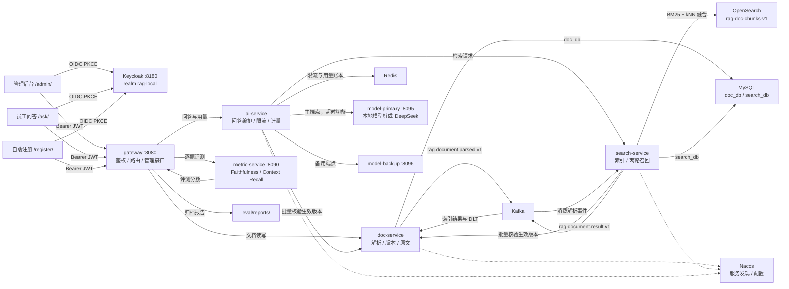
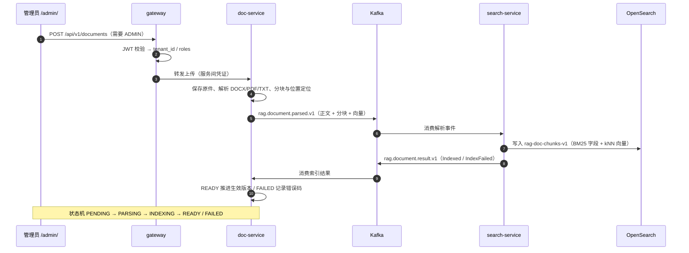
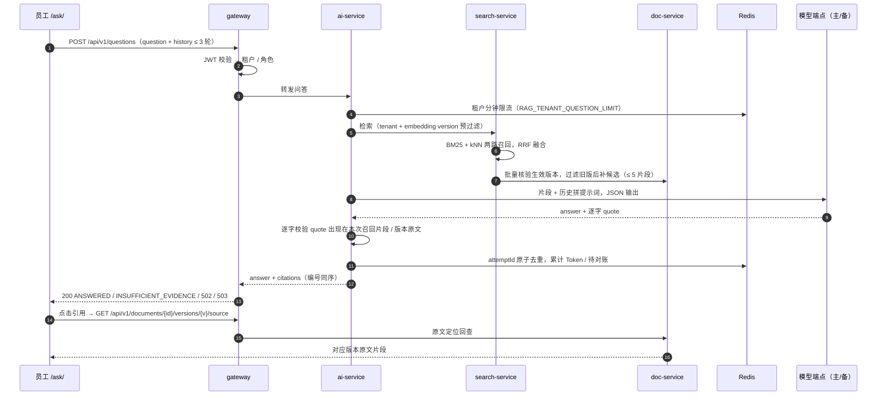

# 知源 · 企业级 RAG 知识平台

管理员可通过企业单点登录上传资料、追加版本并查看生效状态及租户用量，也可在工作台的「RAGAS 评测」「系统监控」「用户与权限」页面运行质量评测、查看服务健康与治理指标、审阅账号与角色。员工可在问答页查询本租户的已发布资料，点击回答里的引用回查文档版本与原文位置。网关验证身份和租户，文档服务解析原件，检索服务通过 Kafka 消费解析事件并写入 OpenSearch。AI 服务执行租户限流、主备切换与分项计量，独立 Python 服务运行离线评测。CI、固定版本镜像、K8s 配置与可观测性见「预发到生产」。[项目规划](企业级RAG知识引擎项目规划.md)

## 架构链路

平台按「网关统一鉴权 → 服务内网协作 → 消息与检索解耦」组织：浏览器只访问网关；网关用 Keycloak 签发的 JWT 解析出租户与角色后，按路径把请求转发给文档、检索、问答服务；文档解析与索引通过 Kafka 事件异步衔接；问答是「检索 → 生效版本核验 → 模型生成 → 引文逐字校验」的同步链路；评测、监控与权限治理由网关内的管理接口和独立的 Python 评测服务承担。

### 组件拓扑



### 上传与发布链路

管理员在后台上传文件后，网关校验 `ADMIN` 角色并把请求转发给文档服务；文档服务保存原件，版本从 `PENDING` 进入 `PARSING`，解析并分块（DOCX 定位到段落与表格，PDF 定位到页，TXT 定位到行，文件上限 10 MiB），随后把解析正文、分块和测试向量写入 Kafka；检索服务消费事件后写入 OpenSearch（BM25 字段与 k-NN 向量两路召回，用 RRF 融合），再把索引结果写回 Kafka；文档服务消费结果后把版本推进为 `READY`（成为生效版本）或 `FAILED`（记录错误码），坏消息进入 `.DLT`。



### 问答与引用链路

员工在问答页提交问题（可带最近 3 轮历史），网关校验 JWT 与租户后转发给 AI 服务；AI 服务先做租户限流，再把「最近两轮提问 + 当前追问」拼成检索查询发给检索服务；检索服务预过滤租户与向量模型版本，做 BM25 与 k-NN 两路召回并用 RRF 融合，再批量向文档服务核验生效版本、过滤旧版并补取候选（最多 5 个片段）；AI 服务把片段与历史拼进提示词调用模型主备端点，对模型返回的每条引文逐字校验是否出现在本次召回片段与对应版本原文中，通过后返回带编号的 `citations`；历史只用于理解追问，不作为证据。



### 评测、监控与治理链路

- **评测。** 管理员 `POST /api/v1/evals`，网关逐题调用 `metric-service` 的 `/internal/v1/evaluations`（固定评测集 `eval/golden.json`，40 题含 30 道有答案与 10 道资料不足），得到 Faithfulness 与 Context Recall 后脱敏归档到 `eval/reports/`；质量门禁为有答案样本平均 Faithfulness ≥ 0.90、Context Recall ≥ 0.85。离线等价方式是 `docker compose run --rm metric-eval`，直连评测服务。
- **监控。** 管理页 `#/monitoring` 读取 `GET /api/v1/monitoring`：网关并行探测 10 个组件（4 个 Java 服务、Keycloak、OpenSearch、Nacos 与两个模型端点）并汇总各服务 `/actuator/prometheus` 指标；Prometheus 抓取网关指标，Grafana 看板见 `observability/`。
- **身份与租户。** Keycloak 签发 JWT（`rag-local` realm、公开客户端 `rag-web`、S256 PKCE）；网关用 JWKS 验签，`tenant_id` 属性与 `realm_access.roles` 决定租户隔离与 `ADMIN`/`EMPLOYEE` 能力；`/api/v1/access` 通过 Keycloak 管理接口读取账号目录，`/api/v1/register` 匿名创建账号并授予 `EMPLOYEE`；邀请码 8 位、每 120 分钟轮换，持久化在 `data/invite-codes.json`。
- **计量与对账。** 每次真实模型调用分配 `attemptId` 并原子去重写入 Redis 账本（按租户、日期、模型与用途累计输入/输出 Token），`/api/v1/usage` 展示 Token、待对账次数与估算费用；超出限流返回 `429` 与 `Retry-After`。
- **基础设施。** MySQL 按服务隔离 `doc_db` / `search_db` 并由 Flyway 迁移；Kafka 解耦解析与索引；OpenSearch 承担混合检索；Redis 承载限流与用量；Nacos 提供服务发现；模型端点默认本地测试桩，可通过 `.env` 切到 DeepSeek 等 OpenAI 兼容端点（主端点超时、`429` 或 `5xx` 时在总时限内最多切备一次，连续失败两次熔断，冷却结束后半开探测）。

## 本地启动与验收

启动 Docker Desktop 的 Linux 引擎。构建使用 JDK 21、Maven、Node.js 24 和 PowerShell 7.2 或更新版本。验收脚本在 Python 3.12 上验证。

```powershell
./scripts/start.ps1
python ./scripts/smoke.py
python ./scripts/smoke_phase2.py
python ./scripts/smoke_phase3.py
python ./scripts/smoke_phase4.py
python ./scripts/contract_tests.py
python ./scripts/smoke_phase5.py
docker compose ps
```

发布门禁的一键等价命令为 `./scripts/verify_release.ps1`，与 CI 校验项保持一致。

启动脚本检查 Docker 和 OIDC 配置，构建 Vue 页面和 Java 服务，补齐新增服务间凭证并等待 Compose 就绪。MySQL、Kafka 和 OpenSearch 使用各自的数据卷。启动凭证保存在 `.env`，暂停可运行 `docker compose stop`。

| 本机入口 | 用途 |
|---|---|
| `http://127.0.0.1:8080/admin/` | 上传、追加版本、查看进度与文档详情、下载原文件 |
| `http://127.0.0.1:8080/ask/` | 员工问答、查看引用与原文 |
| `http://127.0.0.1:8080/actuator/health` | 网关健康状态 |
| `GET http://127.0.0.1:8080/api/v1/identity` | 查看自己的主体、租户和角色 |
| `GET http://127.0.0.1:8080/api/v1/documents?page=0&size=20` | 管理员读取本租户文档列表 |
| `GET http://127.0.0.1:8080/api/v1/usage?date=YYYY-MM-DD` | 管理员读取本租户按模型的用量与估算费用 |
| `GET http://127.0.0.1:8080/api/v1/evals` | 管理员读取归档的 RAGAS 评测报告列表 |
| `POST http://127.0.0.1:8080/api/v1/evals` | 管理员在线运行金标评测并归档报告 |
| `GET http://127.0.0.1:8080/api/v1/monitoring` | 管理员读取服务健康、延迟与治理指标 |
| `GET http://127.0.0.1:8080/api/v1/access` | 管理员读取 Keycloak 账号目录与角色矩阵 |
| `http://127.0.0.1:8080/register/` | 凭邀请码自助注册，注册后为普通成员 |
| `POST http://127.0.0.1:8080/api/v1/register` | 匿名注册（邀请码 + 用户名 + 密码） |
| `GET http://127.0.0.1:8080/api/v1/invite-codes` | 管理员读取本租户当前邀请码与历史 |
| `POST http://127.0.0.1:8080/api/v1/invite-codes/rotate` | 管理员立即轮换邀请码 |
| `POST http://127.0.0.1:8080/api/v1/users/{username}/promote` | 管理员擢升本租户用户为管理员 |
| `POST http://127.0.0.1:8080/api/v1/users/{username}/demote` | 管理员将本租户管理员降为普通成员 |
| `http://127.0.0.1:8080/actuator/prometheus` | Prometheus 指标端点（内网抓取） |
| `http://127.0.0.1:8080/actuator/health/readiness` | K8s 就绪探针 |
| `http://127.0.0.1:8180/realms/rag-local/.well-known/openid-configuration` | 本地 OIDC 发现文档 |

网关和本地 Keycloak 绑定到回环地址。文档、检索、AI、评测、Nacos、Kafka、OpenSearch、Redis 和 MySQL 通过 Compose 网络通信。文档服务与检索服务使用独立 MySQL 账号，Flyway 分别对 `doc_db` 和 `search_db` 执行迁移。

`smoke.py` 验证第一阶段的 OIDC 登录、租户隔离、Nacos 服务发现、Flyway 迁移及 Java 到 Python 的连通性。可用 `docker compose run --rm metric-probe` 单独检查离线连通性。

`smoke_phase2.py` 验证三种文件的原文定位、上传限制、幂等和并发追加、延迟索引、重复投递、乱序完成、扫描件失败，以及 OpenSearch 拒绝写入后的版本状态和 Kafka 死信。脚本会暂时暂停检索服务及切换索引写入状态，请在本地验收环境没有其他上传任务时运行。测试创建的 MySQL 和 OpenSearch 记录在结束后清理。

`smoke_phase3.py` 使用本地可控模型验证双租户问答、无依据拒答、生效版本切换、旧引用回查及依赖故障。脚本会短暂暂停 Kafka、检索服务和文档服务，适用于独立的本地验收环境。模型输出校验与两路召回过滤的单测由 `mvn verify` 执行。

`smoke_phase4.py` 验证主端点超时切备、双端点故障、按端点熔断与半开恢复、租户限额、逐次调用的计量与待对账、评测停机演练及报告重跑。脚本会切换本地模型桩状态并短暂暂停评测服务，测试创建的文档、OpenSearch 记录和 Redis 计数在结束后清理。

`contract_tests.py` 校验 `contracts/interfaces.json` 描述的内部与外部接口契约。`smoke_phase5.py` 执行第五阶段验收，详见「预发到生产」。

## 文档发布

上传接口返回 `202` 后，版本进入 `PENDING`，并继续经历 `PARSING`、`INDEXING`、`READY` 或 `FAILED`。管理员可同时查看最新上传版本和当前生效版本，也可打开文档详情查看解析正文、版本信息并下载原文件。OpenSearch 刷新后，检索服务按租户、文档和版本核对可搜索分块数量。文档服务收到成功事件才推进生效版本。

DOCX 按正文与表格段落定位，PDF 使用页号，TXT 使用行号，均从 1 开始。文件上限为 10 MiB。解析最多保存 10,485,760 个 UTF-16 代码单元和 10 万个非空位置，超出上限返回 `DOCUMENT_TOO_COMPLEX`。扫描 PDF 进入 `FAILED`，原因是 `NO_EXTRACTABLE_TEXT`。

本地默认使用 128 维的 `local-test-v1` 测试向量。对接获批的 OpenAI 兼容向量端点时，在 `.env` 中设置 `RAG_EMBEDDING_URL`、`RAG_EMBEDDING_MODEL`、`RAG_EMBEDDING_VERSION` 和 `RAG_EMBEDDING_DIMENSIONS`，按端点要求提供 `RAG_EMBEDDING_API_KEY`。切换模型版本或向量维度时，为该配置指定独立的 `RAG_OPENSEARCH_INDEX`。本地 Compose 使用 Kafka 4.2.2 和 OpenSearch 3.10.0。[Kafka 发布版本](https://kafka.apache.org/downloads/) · [OpenSearch 发布版本](https://opensearch.org/downloads/)

## 问答与引用

`POST /api/v1/questions` 接收 `{"question":"入职满一年能休几天年假？"}`。检索服务对两路召回预过滤租户和向量模型版本，使用 RRF 融合 BM25 与 k-NN 排名，再批量向文档服务核验生效版本。过滤旧版后补取候选，最多传给模型 5 个片段。[OpenSearch 多搜索接口](https://docs.opensearch.org/latest/api-reference/search-apis/multi-search/) · [RRF](https://docs.opensearch.org/latest/vector-search/ai-search/hybrid-search/rrf/)

问答页是连续会话：回答之后底部固定输入栏可继续追问，前端把最近 3 轮问答作为可选 `history` 一并提交（如 `{"question":"它适用于哪些城市？","history":[{"question":"出差住宿标准是多少？","answer":"…"}]}`）。AI 服务最多采用最近 4 轮，用「最近两轮提问 + 当前追问」拼成检索查询来消解指代，并把历史放进提示词帮助理解追问意图；历史只用于理解问题，不作为证据——引用仍必须逐字出现在本次召回的片段与对应版本原文中，多轮不会放宽引用校验。历史缺失、超长或格式非法时按无历史处理，单轮问答行为不变。

答复里的编号与 `citations` 同序。引用必须来自本次召回，并精确匹配对应版本的原文。`GET /api/v1/documents/{id}/versions/{v}/source?unit=line&start=1&end=1` 根据引用的定位读取原文，也可打开同租户历史已发布版本。资料不足返回 `INSUFFICIENT_EVIDENCE` 和空引用。模型输出或引文校验失败返回 `502`，依赖系统不可用返回 `503`。

本地默认从可控模型桩提取原句，便于复验。对接获批的 OpenAI 兼容对话服务，在 `.env` 设置 `RAG_CHAT_URL`（完整 Chat Completions 地址）、`RAG_CHAT_MODEL`，按端点要求提供 `RAG_CHAT_API_KEY`。备用端点使用 `RAG_CHAT_BACKUP_URL`、`RAG_CHAT_BACKUP_MODEL` 和 `RAG_CHAT_BACKUP_API_KEY`。公司资料仅在显式配置模型端点后发送给相应端点。

### 接入 DeepSeek

当前 `.env` 指向 DeepSeek（OpenAI 兼容接口）。关键设置：

| 变量 | 值 | 说明 |
| --- | --- | --- |
| `RAG_CHAT_URL` | `https://api.deepseek.com/chat/completions` | 完整 Chat Completions 地址 |
| `RAG_CHAT_MODEL` | `deepseek-flash` | 也可换 `deepseek-v4-pro`，单价更高 |
| `RAG_CHAT_API_KEY` | `sk-...` | 只在 `.env` 中保存，不写进镜像 |
| `RAG_CHAT_THINKING` | `disabled` | DeepSeek 默认开启思维链；问答只要结论，关闭后延迟与输出 Token 都更低 |
| `RAG_CHAT_JSON_MODE` | `true` | 请求带 `response_format={"type":"json_object"}`，模型直接返回可校验的 JSON |
| `RAG_CHAT_TIMEOUT_MS` | `20000` | 真实网络往返更慢，同时仍小于 40 秒问答预算 |
| `RAG_CHAT_PRICE_INPUT_PER_MILLION` / `..._OUTPUT_...` | `2.13` / `8.52` | 按 DeepSeek 高峰价折算的人民币单价，仅用于估算展示 |
| `RAG_CHAT_BACKUP_URL` | 空 | 留空即关闭切备，避免失败时静默回落到本地模型桩 |

`RAG_CHAT_THINKING` 留空表示不发送 `thinking` 字段，因此换回不识别该参数的端点只需清空它；`RAG_CHAT_JSON_MODE=false` 可关闭 JSON 模式。真实模型的 `quote` 必须逐字取自片段原文，服务端校验失败会记录 `answer ... rejected=quote-not-in-chunk|shape` 并以 `502` 返回，便于按日志调整提示词。`smoke_phase4.py` 的切备、熔断与 429 演练依赖模型桩的 `/control` 接口，跑这类用例时需把上述变量恢复为 `model-primary`/`model-backup` 默认值。

## 模型治理与用量

本地默认使用两个 HTTP 模型桩：`model-primary` 与 `model-backup`，只在本地网络监听，可通过控制接口切换正常、超时、`429` 和 `5xx`。主端点超时、供应商 `429` 或 `5xx` 时，在请求总时限内最多切备一次；按端点连续失败两次后熔断，冷却结束放行一次半开探测。租户每分钟问答数由 `RAG_TENANT_QUESTION_LIMIT` 控制，超额返回 `429` 和 `Retry-After`，且不会再调用模型或检索。

`ai-service` 使用 Redis 按租户、日期、模型和用途累计输入与输出 Token。每次实际模型调用分配独立 `attemptId` 并原子去重；超时的调用无法确认供应商是否计费，列入待对账。管理员在管理页或 `GET /api/v1/usage?date=YYYY-MM-DD` 查看 Token、待对账次数、估算费用与币种。单价按每百万 Token 由 `RAG_CHAT_PRICE_INPUT_PER_MILLION`、`RAG_CHAT_PRICE_OUTPUT_PER_MILLION` 及对应备用端点变量设置，币种由 `RAG_USAGE_CURRENCY` 设置。

## 离线评测

`metric-service` 在 `POST /internal/v1/evaluations` 对单题返回 Faithfulness 与 Context Recall 分数；没有参考答案时 `context_recall` 为空。本地实现为不依赖外部模型的确定性词面覆盖评分，生产接入获批的 RAGAS 评测模型。固定评测集位于 `eval/golden.json`，离线 Java 作业通过 `docker compose run --rm metric-eval` 直连 `metric-service:8090`，逐题评分并把报告归档到 `eval/reports/`。服务不可用时作业以失败退出，报告保留失败原因与空分数，恢复后同一批样本可直接重跑。在线问答不依赖评测服务。金标扩到 40 题（30 有答案 + 10 资料不足），报告在归档前对邮箱、手机号、身份证等脱敏，详见「预发到生产」。网关也提供在线运行入口 `POST /api/v1/evals`，逐题调用同一评测服务并把报告写入网关挂载的 `eval/reports/`。

## 管理控制台（评测、监控与权限）

管理页侧栏新增「管理」分组，对应四个哈希路由：`#/evaluation`（RAGAS 评测）、`#/monitoring`（系统监控）、`#/access`（用户与权限）、`#/invites`（邀请码）。页面与接口仅对 `ADMIN` 开放，员工访问会被网关拒绝并显示无权限说明。

**RAGAS 评测。** `GET /api/v1/evals` 按时间倒序返回归档报告摘要，`GET /api/v1/evals/{reportId}` 返回平均值与逐题分数，`POST /api/v1/evals` 在线运行 `eval/golden.json` 并归档新报告；运行期间再次提交返回 `409 EVALUATION_IN_PROGRESS`。质量门禁沿用 30 道有答案样本的平均 Faithfulness ≥ 0.90、Context Recall ≥ 0.85，界面会同时显示整体均值与门禁结论。网关以非 root 用户写挂载目录，Compose 通过 `./eval:/app/eval` 提供数据目录。

**系统监控。** `GET /api/v1/monitoring` 并行探测网关、文档、检索、问答、评测、Keycloak、OpenSearch、Nacos 与两个模型端点的健康状态及延迟，再从各服务 `/actuator/prometheus` 汇总累计提问、成功率、平均耗时、输入/输出 Token、模型切换、Kafka 待发事件与索引失败。单个探测失败只影响该行状态，不会让整页报错。

**用户与权限。** `GET /api/v1/access` 由网关用 Keycloak 管理账号读取 realm `rag-local` 的用户与 realm 角色映射，返回账号、邮箱、租户、角色、启用状态与创建时间，以及 `ADMIN`/`EMPLOYEE` 的能力矩阵。Keycloak 不可用时接口返回 `200` 且 `directory.available=false`，页面显示告警并保留角色说明。测试 realm 的 `tenant_id` 属性同时以 `tenant-a`/`tenant-b` 分组保存，网关优先读属性、缺失时回退读分组，保证导入后的目录稳定可用。管理员可通过 `POST /api/v1/users/{username}/promote` 与 `/demote` 擢升或降级本租户账号；跨租户返回 `403`，修改自己返回 `400 CANNOT_MODIFY_SELF`，角色变更在用户重新登录后生效。

**邀请码与注册。** 每个租户拥有一枚 8 位大写邀请码（字母表 `ABCDEFGHJKMNPQRSTUVWXYZ23456789`），每 120 分钟自动轮换，管理员也可在 `#/invites` 页立即轮换；历史邀请码保留最近 10 条。邀请码持久化在网关挂载的 `${RAG_INVITE_DIR:-/app/data}/invite-codes.json`。`POST /api/v1/register` 仅限匿名访问，校验邀请码、用户名（3–32 位字母/数字/点/下划线/连字符）与密码（8–128 位）后，通过 Keycloak 管理接口创建用户、绑定租户分组并授予 `EMPLOYEE` 角色，注册成功返回 `201`；用户名重复返回 `409 USERNAME_TAKEN`。注册页位于 `/register/`，登录页使用 Keycloak 自定义主题 `rag`（`docker/keycloak/themes/rag`，以 `base` 主题为父主题）。

新增本地凭证：`.env` 中的 `RAG_KEYCLOAK_ADMIN_USER`（默认 `rag-admin`）与 `RAG_KEYCLOAK_ADMIN_PASSWORD` 由 `scripts/start.ps1` 生成，Compose 用它们创建 Keycloak 主域管理员并注入网关；`RAG_EVAL_DIR` 默认 `/app/eval`，`RAG_METRIC_URL` 默认 `http://metric-service:8090`，`RAG_INVITE_DIR` 默认 `/app/data`（Compose 挂载 `./data:/app/data`）。

## 预发到生产（第五阶段）

**CI 与发布门禁。** `.github/workflows/ci.yml` 在 JDK 21、Node 24、Python 3.12 上执行 `mvn verify`、前端构建、Compose 与 K8s 配置校验，启动全套服务后运行契约测试与五份阶段验收，最后归档发布清单、评测报告及备份校验和。本地等价门禁为 `./scripts/verify_release.ps1`；CI 首次运行用 `python scripts/ci_env.py` 生成隔离凭证。

**固定版本镜像。** `VERSION` 定义语义版本，`docker/java.Dockerfile` 的基础镜像按 `sha256` 摘要锁定，自构建镜像注入 `org.opencontainers.image.version` 与 `revision` 标签。`compose.yaml` 通过 `RAG_IMAGE_TAG` 输出 `ragknowledge/<服务>:<tag>`。`python scripts/release.py --revision <git-sha>` 为各服务打上不可变标签 `0.1.0-<12 位 revision>` 并生成 `release/<tag>.json` 清单（镜像 ID、OCI 标签、上一版 tag）；同名标签已存在时拒绝覆盖，`--check` 校验清单与镜像一致。

**K8s 配置。** `k8s/` 提供 Namespace、ConfigMap、5 个应用 Deployment、基础设施、Service、Ingress、PDB 与 `kustomization.yaml`。应用 Deployment 使用固定版本镜像、startup / liveness / readiness 三类探针（`/actuator/health/liveness`、`/actuator/health/readiness`）、CPU 与内存 requests/limits、`maxUnavailable: 0` 滚动发布和 `revisionHistoryLimit: 10`；密钥通过 `secretRef` 注入。`k8s/secret.example.yaml` 仅为占位模板且不纳入 kustomization，真实值由 Sealed Secrets / Vault / CSI driver 提供。`python scripts/validate_k8s.py` 校验探针、资源、镜像标签、密钥引用与 Grafana 指标；`--align-release` 把镜像 tag 对齐到最新发布清单。`python scripts/ops/rollback.py --dry-run` 输出回滚到上一版镜像 tag 的 `kubectl set image` 计划。

**可观测性。** 四个 Java 服务暴露 `/actuator/prometheus`，业务指标包括 `rag_questions_seconds`（问答延迟直方图）、`rag_question_results_total`、`rag_model_tokens_total`、`rag_model_failover_total`、`rag_kafka_pending_events` 和 `rag_index_failures_total`。`observability/prometheus/prometheus.yml` 用 K8s Pod 发现抓取，`observability/grafana/dashboards/rag-overview.json` 展示问答延迟 P95、失败率、Kafka 积压、索引失败、模型切换与 Token 用量。网关生成并透传 `X-Trace-Id`，网关、问答、检索、原文回查与模型调用日志都带 traceId、错误码与耗时；`observability/skywalking/agent-patch.yaml` 提供可选的 SkyWalking javaagent 接入（部署 OAP 后在 kustomization 中启用 patches）。

**契约测试。** `contracts/interfaces.json` 描述第三节的 20 条外部与 10 条内部接口。`python scripts/contract_tests.py` 静态核对网关与服务实现，并对运行中的服务验证角色隔离、响应结构、统一错误信封（`code` / `message` / `traceId`）、参数与媒体类型错误，以及 metric-service 的服务凭证校验。

**评测与脱敏。** `eval/golden.json` 扩到 40 题（30 道有答案 + 10 道资料不足，含 1 道负例和 1 道含手机号、邮箱的样本）。离线作业归档前脱敏邮箱、手机号、身份证、IP 与长数字，报告标记 `redacted: true`；发送给评测服务的原文不变。`smoke_phase5.py` 核对可答题平均 Faithfulness ≥ 0.90、Context Recall ≥ 0.85，资料不足题不计算 Context Recall，负例记入低分清单。

**运维演练。** `python scripts/ops/backup_restore.py backup|restore` 生成 `doc_db` + `search_db` 逻辑备份（SHA-256、`--hex-blob`），恢复时导入同实例影子库核对行数后删除，线上数据不被覆盖。`python scripts/ops/reindex.py` 从 `search_db.doc_chunk` 重建 OpenSearch 影子索引（本地测试向量），核对文档数、中文关键词与 k-NN 查询后清理。对应 `.sh` 为 Linux/CI 薄包装；生产重建索引须改用获批向量端点，脚本检测到非本地向量模型会拒绝外发语料。

`python scripts/smoke_phase5.py` 实跑以上验收：契约、探针与指标、traceId 串联、金标与脱敏、备份恢复、索引重建、固定版本镜像、发布清单、K8s 对齐及上一版镜像回滚演练。测试数据、影子库与影子索引在结束后清理；发布清单、备份与评测报告作为审计证据保留。

## 企业 OIDC 对接

本地 Keycloak 使用 `rag-local` realm、公开客户端 `rag-web` 及 `S256` PKCE。管理员账号为 `a-admin` 和 `b-admin`，员工账号为 `a-employee` 和 `b-employee`，分别归属 `tenant-a` 和 `tenant-b`；另有用于权限边界测试的 `no-role` 与 `no-tenant`。测试密码为 `RagLocalExample42!`。测试 realm 随 Keycloak 重启重新导入，除 `tenant_id` 用户属性外还定义 `tenant-a`/`tenant-b` 两个分组供账号目录兜底读取。Compose 通过 `KC_BOOTSTRAP_ADMIN_USERNAME`/`KC_BOOTSTRAP_ADMIN_PASSWORD` 创建 Keycloak 主域管理员供网关查询账号目录。

企业 IdP 对接时配置 `RAG_OIDC_ISSUER`、`RAG_OIDC_JWKS_URI`、`RAG_OIDC_AUDIENCE` 和 `RAG_OIDC_CLIENT_ID`。在 IdP 中登记实际网站的 `/admin/` 和 `/ask/` 登录及退出回调，并允许该网站来源。IdP 在签名访问令牌里提供 `sub`、`exp`、`tenant_id` 和 `roles`。`tenant_id` 为最长 64 字符的小写字母、数字和连字符标识，以字母或数字开头。`roles` 数组使用 `ADMIN` 和 `EMPLOYEE`。

Java 使用 JDK 21、Spring Boot 4.0.9、Spring Cloud 2025.1.4 和 Spring Cloud Alibaba 2025.1.0.0。[Spring Cloud 发布说明](https://spring.io/blog/2026/10/23/spring-cloud-2025-1-4-has-been-released/) · [Spring Cloud Alibaba 兼容矩阵](https://sca.aliyun.com/docs/2025.x/overview/version-explain/)
