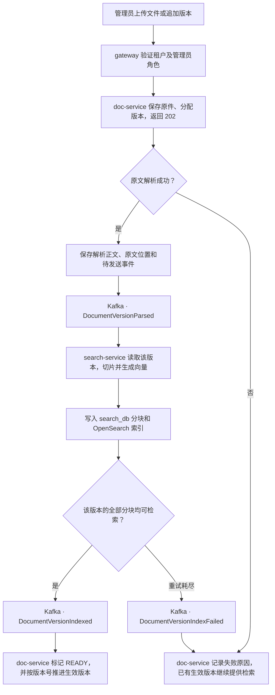
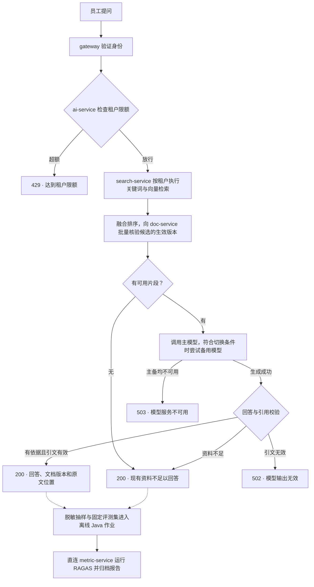

# 企业级 RAG 知识引擎项目规划与接口验收

首版以一条业务链路作为验收标准。HR 上传《年假政策》后能看到它何时生效。员工用自然语言提问，能从答案点回对应版本的原文。HR 更新制度后，新问题引用新版，旧回答仍能打开当时的依据。主模型故障时，系统尝试备用模型。运营人员能查到问答的耗时、用量和估算成本。

## 一、需求功能与服务分工

首版交付网页和 API，收录企业内全员可见的资料，不同租户独立。支持 DOCX、文本型 PDF 和 UTF-8 TXT。向量化、问答和评测统一使用企业批准的模型端点。

| 模块 | 端口与存储 | 需要交付的功能 |
|---|---|---|
| 管理员网页 | Vue 3，经 gateway 访问 | 上传文档、追加版本、查看解析进度和失败原因、区分最新上传版与当前生效版、查看租户用量 |
| 员工网页 | Vue 3，经 gateway 访问 | 输入问题、阅读带编号引用的回答、点击引用查看文档标题、版本、原文及位置，能区分资料不足和服务故障 |
| gateway | Java，8080，无业务库 | 对接企业单点登录，验证 JWT 和角色，转发请求。租户身份取自验证通过的令牌 |
| doc-service | Java，8082，MySQL `doc_db` | 保存原件、解析正文、保留位置、管理追加式版本，提供原文回查，决定哪个版本生效 |
| search-service | Java，8083，MySQL `search_db`、OpenSearch | 切片、向量化、建索引，按租户执行中文关键词和向量检索，返回当前生效版本的证据片段 |
| ai-service | Java，8081，Redis | 编排检索与生成、校验引用、执行租户限流和主备切换、统计 Token 与成本 |
| metric-service | Python，8090，无业务库 | 运行 RAGAS，向离线作业返回逐题分数或失败原因。独立构建，Java 通过内网 HTTP 直连 |

四个 Java 模块纳入 Maven 父工程，使用 Nacos 做服务发现。Python 服务独立于 Maven 和 Nacos。Java 侧默认采用 JDK 21，Spring Boot、Spring Cloud 与 Spring Cloud Alibaba 按官方兼容矩阵选取同一组合并锁定版本。[Spring Cloud Alibaba 版本说明](https://sca.aliyun.com/docs/2025.x/overview/version-explain/)

## 二、核心流程与数据设计

### 管理员上传与版本生效



**上传成功与制度生效是两个可观察的时刻。** `202` 表示原件和版本号已保存。管理员通过状态接口查看 `PENDING → PARSING → INDEXING → READY`，失败时得到 `FAILED` 和 `errorCode`。例如 v2 建索引期间，员工仍查到 v1。v2 全部可检索后才切换，迟到的 v1 事件不能让制度回退。

| 数据对象 | 在原始表设计上需要补齐的内容 |
|---|---|
| `doc_db.kb_document` | 保留租户和标题，增加 `latest_version`、`active_version`。首次发布前 `active_version` 为空 |
| `doc_db.kb_document_version` | 保留 `(document_id, version)` 唯一约束，保存不可变原件、解析正文、位置、状态、失败原因。首版默认单文件上限 10 MiB，原件随版本存入 MySQL |
| `search_db.doc_chunk` | 增加版本、原文起止位置和向量模型版本，对 `(tenant_id, document_id, version, chunk_index)` 建唯一约束。同一块重放后沿用同一索引 ID |
| 服务本地事件表 | 版本状态与待发 Kafka 事件在同一数据库事务提交。事件包含 `eventId`、租户、文档、版本。消费者可安全重放，失败耗尽进入死信队列 |

DOCX 引用定位到段落，PDF 定位到页，TXT 定位到行，序号从 1 开始。切片保留原文位置。数据库迁移显式指定 `doc_db` 和 `search_db`，两个服务通过接口和事件交换数据。

### 员工问答与离线评测



- **检索。** 中文关键词使用 OpenSearch 的 `cjk` 分析器与 BM25，文档与问题使用同一版本的向量模型。两路在召回时都过滤租户，再用 RRF 合并排名。过滤旧版本后补取候选，最多向模型提供 5 个有效片段。RRF 分数仅用于排序。[中文分析器](https://docs.opensearch.org/latest/analyzers/language-analyzers/cjk/) · [混合查询过滤](https://docs.opensearch.org/latest/query-dsl/compound/hybrid/) · [RRF 排名融合](https://docs.opensearch.org/latest/vector-search/ai-search/hybrid-search/rrf/)
- **引用。** 模型只能引用本次检索返回的片段。`ai-service` 校验片段 ID、版本及引文是否真实出现在原文中，服务端生成回查位置。引用有效性由程序检查，结论是否得到原文支持通过金标和评测检查。检索服务或版本核验服务不可用时返回 `503`。
- **模型治理。** 租户超过限额返回 `429` 和 `Retry-After`。主端点超时、返回供应商侧 `429` 或 `5xx` 时，在请求总时限内最多切备一次。按端点独立熔断，冷却后用半开探测恢复。
- **用量与成本。** 每次实际模型调用分配独立 `attemptId`，按租户、日期、模型及用途统计输入和输出 Token。Redis 原子去重累计。一次问答若主备均产生计费，两笔都计入。超时且缺少供应商用量的尝试列入待对账，费用按调用当日的模型单价估算。

## 三、接口契约与联调示例

外部接口统一经过 `http://localhost:8080/api/v1`。`ADMIN` 可以管理本租户文档和用量，`EMPLOYEE` 可以提问、读取本租户已发布版本的引用。内部接口校验服务身份及租户上下文。

| 调用方 | 方法与路径 | 输入 | 成功结果 |
|---|---|---|---|
| 管理员 | `POST /documents` | multipart `title`、`file`，请求头 `Idempotency-Key` | `202`，返回 `documentId`、`version`、`status` |
| 管理员 | `POST /documents/{id}/versions` | multipart `file`，请求头 `Idempotency-Key` | `202`，返回同一文档的新版本号 |
| 管理员 | `GET /documents`、`GET /documents/{id}/versions` | `page`、`size` | `200`，分页文档列表或版本历史 |
| 管理员 | `GET /documents/{id}/versions/{v}` | 指定文档及版本 | `200`，返回 `status`、`activeVersion`、`errorCode` |
| 员工、管理员 | `POST /questions` | `{"question":"入职满一年能休几天年假？"}` | `200`，返回回答状态、答案、引用和 `traceId` |
| 员工、管理员 | `GET /documents/{id}/versions/{v}/source` | `unit`、`start`、`end` | `200`，返回该版本指定位置的 `text`，跨租户访问返回 `404` |
| 管理员 | `GET /usage?date=YYYY-MM-DD` | 租户身份、查询日期 | `200`，按模型和用途返回 Token、估算费用、币种和待对账次数 |
| ai → search | `POST /internal/v1/retrieval` | `question`、`topK`、可信租户身份 | `200`，返回已核验的证据片段、版本和位置 |
| search → doc | `GET /internal/v1/documents/{id}/versions/{v}/parsed`、`POST /internal/v1/documents/active-versions` | 指定版本，或一批候选文档 ID | `200`，分别用于建索引时读取解析内容、检索时核验生效版本 |
| 离线 Java 作业 → metric | `POST /internal/v1/evaluations`，直连 `metric-service:8090` | `user_input`、`response`、`retrieved_contexts`、可选 `reference` | `200`，返回本题分数。无参考答案时 `context_recall` 为空 |

**问答成功响应示例**取自虚构的验收文档。答案中的 `[1]` 对应 `citations` 的第一项。

```json
{
  "status": "ANSWERED",
  "answer": "入职满一年，可休 7 天公司年假。[1]",
  "citations": [{
    "documentId": "42",
    "title": "年假政策",
    "version": 1,
    "chunkId": "801",
    "locator": {"unit": "line", "start": 1, "end": 1},
    "quote": "入职满一年，可休 7 天公司年假。"
  }],
  "traceId": "example-trace"
}
```

没有依据时返回 `200`、`status=INSUFFICIENT_EVIDENCE` 和空引用数组。错误响应统一包含 `code`、`message`、`traceId`。空问题返回 `400`，未登录返回 `401`，角色不足返回 `403`。上传超过上限返回 `413`，不支持的格式返回 `415`。合法 PDF 在异步解析时发现没有可提取文本，版本进入 `FAILED`，原因记为 `NO_EXTRACTABLE_TEXT`。

### PowerShell 7 端到端接口测试

服务启动后，在独立的空验收租户运行。环境变量 `RAG_ADMIN_TOKEN` 和 `RAG_EMPLOYEE_TOKEN` 分别提供同租户管理员和员工的测试令牌。示例会上传一行制度，等待指定版本生效，再以员工身份提问并核对原文。

```powershell
$ErrorActionPreference = 'Stop'
$api = 'http://localhost:8080/api/v1'
$admin = @{ Authorization = "Bearer $env:RAG_ADMIN_TOKEN" }
$staff = @{ Authorization = "Bearer $env:RAG_EMPLOYEE_TOKEN" }
$file = Join-Path ([IO.Path]::GetTempPath()) ("rag-{0}.txt" -f [guid]::NewGuid())
[IO.File]::WriteAllText($file, '入职满一年，可休 7 天公司年假。')

try {
    $headers = $admin + @{ 'Idempotency-Key' = [guid]::NewGuid().ToString() }
    $form = @{ title = '年假政策'; file = (Get-Item -LiteralPath $file) }
    $doc = Invoke-RestMethod "$api/documents" -Method Post -Headers $headers -Form $form -StatusCodeVariable httpCode -TimeoutSec 20
    if ($httpCode -ne 202) { throw "上传返回 $httpCode" }

    $versionUrl = "$api/documents/$($doc.documentId)/versions/$($doc.version)"
    $deadline = [datetime]::UtcNow.AddMinutes(2)
    do {
        $v = Invoke-RestMethod $versionUrl -Headers $admin -TimeoutSec 10
        if ($v.status -eq 'FAILED') { throw "索引失败 $($v.errorCode)" }
        if ($v.status -eq 'READY') { break }
        Start-Sleep -Seconds 1
    } while ([datetime]::UtcNow -lt $deadline)
    if ($v.status -ne 'READY' -or $v.activeVersion -ne $doc.version) { throw '版本未生效' }

    $body = '{"question":"入职满一年能休几天年假？"}'
    $r = Invoke-RestMethod "$api/questions" -Method Post -Headers $staff -ContentType 'application/json; charset=utf-8' -Body $body -TimeoutSec 20
    $c = $r.citations | Where-Object { $_.documentId -eq $doc.documentId -and $_.version -eq $doc.version } | Select-Object -First 1
    $days = [regex]::Match($r.answer, '([0-9零〇一二两三四五六七八九十百千万点.]+)\s*天').Groups[1].Value
    if ($r.status -ne 'ANSWERED' -or $days -notin '7','七' -or !$c -or $c.quote -notmatch '7\s*天') { throw '答案或引用与样本不符' }

    $p = $c.locator
    if ($p.unit -ne 'line' -or $p.start -ne 1 -or $p.end -ne 1) { throw '应定位到 TXT 第 1 行' }
    $source = Invoke-RestMethod "$versionUrl/source?unit=$($p.unit)&start=$($p.start)&end=$($p.end)" -Headers $staff -TimeoutSec 10
    if (!$source.text.Contains($c.quote)) { throw '原文与引文不符' }
    '上传、索引、问答和引用回查均通过'
} finally {
    Remove-Item -LiteralPath $file
}
```

## 四、测试矩阵与上线门槛

使用两家虚构企业。租户 A 的年假制度 v1 为 **7 天**、v2 为 **9 天**。租户 B 的同名制度为 **13 天**。这样可以直接从答案和引用看出系统是否读错版本或租户。

| 测试场景 | 操作 | 通过标准 |
|---|---|---|
| 解析与定位 | 分别上传 DOCX、两页 PDF、TXT，再上传扫描 PDF | 三种文本文件能定位到正确段、页、行。扫描 PDF 显示可理解的失败原因 |
| 幂等与并发 | 同键重复上传、同键更换内容、并发追加版本 | 重复请求返回同一版本，同键异内容返回 `409`，并发追加产生不同版本号 |
| 新旧版切换 | 延迟 v2 索引，发布后投递迟到的 v1 完成事件，再重放 v2 事件 | 生效前答 7 天，生效后答 9 天。`activeVersion` 保持为 2，分块数稳定，旧引用仍可打开 7 天原文 |
| 租户与角色 | A、B 员工问同一问题，分别检查两路召回候选，再用 B 身份访问 A 的引用 | A 答 9 天，B 答 13 天。两路候选均属于调用租户。跨租户原文返回 `404`，员工上传返回 `403` |
| 无依据与错误引用 | 问资料中没有的制度，再让测试模型返回不存在的片段 ID | 前者返回 `INSUFFICIENT_EVIDENCE` 和空引用，后者返回 `502`，网页不会展示未经校验的答案 |
| 主备与计量 | 模拟主端点超时、双端点故障、租户超额、重复投递同一用量事件 | 分别验证切备成功、`503`、`429` 和同一尝试只计一次。熔断后能半开恢复，超额请求不触发供应商调用 |
| 评测停机 | 停止 `metric-service`，同时发起员工问答与离线评测，恢复后重跑 | 在线仍返回正确答案及引用。离线任务在超时后以失败退出、保留原因和空分数，同一批样本可重跑出报告 |

**质量门槛。** 首批金标建议 40 题，包括 30 道有答案题和 10 道资料不足题。可答题保留人工参考答案及来源版本，试点目标为平均 Faithfulness ≥ 0.90、Context Recall ≥ 0.85。资料不足题单独验收拒答，可答题出现拒答、缺分或评测失败要列入失败清单。引用回查通过率要求 100%，租户泄漏用例必须全部通过。[RAGAS Faithfulness](https://docs.ragas.io/en/stable/concepts/metrics/available_metrics/faithfulness/) · [RAGAS Context Recall](https://docs.ragas.io/en/stable/concepts/metrics/available_metrics/context_recall/)

**性能门槛。** 建议首轮预发基线为 10 万分块、5 次问答/秒、持续 10 分钟，单次输出上限 200 Token。记录实际模型、配额、并发和调用费用，目标为检索 P95 ≤ 800 毫秒、端到端 P95 ≤ 10 秒、`5xx` 比例低于 1%。这些数字用于预发环境的首轮试点验收。

## 五、开发顺序与发布验收

| 阶段 | 交付内容 | 阶段验收 |
|---|---|---|
| 1. 身份与服务骨架 | Java 父工程、独立 Python 服务、网关、数据库迁移、企业 OIDC、两个测试租户 | 验证角色与租户身份。Java 服务能互相发现，离线作业可直连 Python |
| 2. 文档到索引 | 管理员页面、三种解析器、追加版本、Kafka 事件、OpenSearch 索引 | 上传后能看到全过程，完成重复投递、乱序、失败保留旧版测试 |
| 3. 检索到回答 | 混合检索、版本核验、引用校验、员工问答页及原文回查 | 先用可控模型验证错误分支，再用获批真实模型完成跨租户和版本验收 |
| 4. 治理与评测 | 主备模型、限流熔断、分项用量、RAGAS 离线作业及报告 | 完成单端点故障、双端点故障、计量去重与评测停机演练 |
| 5. 预发到生产 | CI 执行构建、单测、契约和集成测试，生成固定版本镜像。K8s 配置就绪探针、资源限制、密钥和滚动发布 | 预发通过金标与压测，验证上一版镜像回滚、MySQL 备份恢复及 OpenSearch 索引重建，再开放企业流量 |

SkyWalking 串联网关、问答、检索、文档和模型调用，错误响应的 `traceId` 应能定位故障环节。Prometheus 采集指标，Grafana 展示问答延迟、失败率、Kafka 积压、索引失败、模型切换和 Token 用量。日志保留排障所需的标识、错误码与耗时，评测样本在归档前脱敏。[Apache SkyWalking](https://skywalking.apache.org/docs/main/latest/en/concepts-and-designs/overview/) · [Grafana Prometheus 数据源](https://grafana.com/docs/grafana/latest/datasources/prometheus/)
